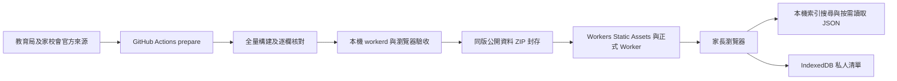

# 香港選校年鑑 · HK_APP

**以官方公開資料建立的香港幼稚園、小學及中學選校資訊網站。** 支援名錄搜尋、年度概覽原文、同學段比較、招生日期與私人選校清單；教育局來源中的特殊學校紀錄亦保留。

[正式網站](https://schools.finpulsx.win) · [全港名錄](https://schools.finpulsx.win/schools) · [年度概覽](https://schools.finpulsx.win/schools?collection=annual) · [資料覆蓋](https://schools.finpulsx.win/sources) · [下載公開資料](https://schools.finpulsx.win/downloads/school-data.zip)

> **先確認分支：正式版本程式在 `release/full-catalog`，不是 `main`。** 本 README 同時提供 GitHub 預設首頁導覽；`main` 的程式尚未合併正式版本。以下目錄及指令均以 `release/full-catalog` 為準。更新 README 不代表更新網站，也不會將正式程式合併至 `main`。
>
> **資料完整性有明確範圍。** 已發布版本完整保留四份選定官方資源的全部紀錄與原始欄位，但不代表所有年份、所有語言、每份收費 PDF 或全港每校的最新招生公告均已整理。來源原文完整，也不等於所有摘要標籤及跨來源配對均已正確；目前辦學分類的顯示限制見[第 4 節](#classification)。

文件核對日期：**2026-09-19**。程式依據：`2b964998ec4052059fa8b902886ab1c36edb6d74`；已部署程式與驗收基準仍為 `de43efa6da11f0dd3660525626b05fd41647ec09`。本文更新只涉及文件，未重新執行程式測試或部署。

## 目錄

[1. 現況與版本](#status) · [2. 功能與頁面](#features) · [3. 資料來源與完整性](#data) · [4. 分類與年份規則](#classification)

[5. 正式架構](#architecture) · [6. 專案目錄](#structure) · [7. 本機啟動](#local) · [8. 測試與驗收](#tests)

[9. Cloudflare 發布](#deployment) · [10. 資料更新](#updates) · [11. 公開資料介面](#interfaces) · [12. 私隱與安全](#security)

[13. 備份與恢復](#backup) · [14. 常見問題](#faq) · [15. 已知限制與待辦](#limitations) · [16. 貢獻與授權](#contributing) · [17. 文件索引](#documents)

<a id="status"></a>
## 1. 現況與版本

### 1.1 正式站及測試站不是同一個部署

| 項目 | 正式公開版 | 舊測試版 |
|---|---|---|
| 網址 | `https://schools.finpulsx.win` | `https://schools-test.finpulsx.win` |
| 工作分支 | `release/full-catalog` | `fix/phase1-stabilization` |
| Worker | `hk-school-guide-production` | `hk-school-guide-test` |
| 前端 | `apps/web/src/full/` | 原有 `apps/web/src/` 頁面與元件 |
| 公開資料儲存 | 版本化 Workers Static Assets | D1 與來源原文靜態檔 |
| 學校搜尋 | 瀏覽器讀取索引後篩選 | Worker API 查詢 D1 |
| 資料範圍 | 四個來源版本全量，不設試點上限 | 部分名錄與 30 個年度配對試點 |
| 搜尋引擎 | 公開頁允許索引；部分路徑設 noindex | noindex |
| 寫入方式 | 重建資料包、驗收後部署 | migration、審核及發佈命令 |

**開發正式版本不需要建立 D1、執行 migration 或匯入試點資料。** 原有 D1 工具仍保留，但不是正式全量網站的必要依賴。

### 1.2 已完成的正式發布基準

| 項目 | 記錄 |
|---|---|
| 已部署程式 commit | `de43efa6da11f0dd3660525626b05fd41647ec09` |
| Workflow | `Full official catalog production release` |
| Run | [35426733829](https://github.com/ray510/HK_APP/actions/runs/35426733829) |
| Prepare / Publish | 均為 `completed / success` |
| 部署結果 | `LIVE_VERIFIED` |
| 核實時間 | `2026-09-19T06:32:24.233Z`，香港時間 14:32:24 |
| 後續線上瀏覽器驗收 | 桌面／手機流程成功；於同日 `06:33:03Z` 完成 |
| 資料版本 ID | `7b73f0d5081f4a1db2a38b9261d9980aac6202b21244a920845148465c6c938a` |

以上是**指定發布的歷史驗收紀錄**，不是永久健康保證，也不代表其後每個文件 commit 均已部署。實際網站版本應核對 `/build-info.json`、`/catalog-manifest.json` 及對應 run。完整證據見 [PRODUCTION_LIVE_ACCEPTANCE.md][production-acceptance]。

<a id="features"></a>
## 2. 功能與頁面

### 2.1 家長使用流程

搜尋學校 → 按學段／地區篩選 → 查看來源版本與完整原文 → 選擇同學段兩至四項比較 → 加入私人清單 → 查看適用招生日期 → 匯出 ICS 或私人備份。

| 功能 | 已有能力 | 使用時注意 |
|---|---|---|
| 全港名錄 | 中文／英文校名、地址、校號搜尋；學段、地區、辦學類別及資料集合篩選 | 結果按來源分組，不等於官方獨立學校總數 |
| 年度概覽 | 三學段選定版本的全部紀錄、完整原始欄位及欄位搜尋 | 未配對名錄的概覽仍可獨立查閱 |
| 學校詳情 | 地址、班別、摘要、名錄各列、概覽原文、來源 hash 及相關日期 | 同名不同地址可透過相關來源連結查看 |
| 學校比較 | 相同學段兩至四項並排比較 | 每項保留來源版次，不保證全部欄位屬同一時期 |
| 招生日曆 | 按入學學年與學段顯示已收錄公告；ICS 匯出 | 事件附申請途徑與適用條件，不代替正式報名 |
| 私人選校清單 | 筆記、申請進度、JSON 匯出與確認後合併匯入 | 只存目前瀏覽器，沒有雲端同步 |
| 來源覆蓋 | 原始／收錄筆數、欄位數、排除數、擷取時間、資料 ZIP | 全量收錄與當屆招生公告覆蓋是不同指標 |

### 2.2 主要路徑

| 路徑 | 用途 |
|---|---|
| `/` | 首頁及搜尋入口 |
| `/schools` | 教育局名錄；預設 `collection=directory` |
| `/schools?collection=annual` | 全部已收錄年度概覽 |
| `/schools?collection=all` | 名錄與年度來源共同搜尋 |
| `/schools?level=PRIMARY&collection=directory` | 小學名錄；`level` 亦可為 `KG`、`SECONDARY`、`SPECIAL`、`OTHER` |
| `/schools/<id>?year=2027` | 某個資料組詳情及目標入學學年 |
| `/compare?ids=<id1>,<id2>&year=2027` | 同學段比較 |
| `/calendar?level=PRIMARY&year=2027` | 已收錄的小一相關公告 |
| `/shortlist` | 私人清單 |
| `/sources` | 來源及完整性報告 |
| `/about` | 平台定位與私隱說明 |

`q`、`district`、`funding`、`collection`、`level`、`year`、`page` 是現有前端搜尋參數。中文字及含空格的值應做 URL 編碼。每頁 24 項是分頁，不是資料抽樣上限。切換「年度概覽」不應繼續拿名錄紀錄數當作概覽筆數。

<a id="data"></a>
## 3. 資料來源與完整性

### 3.1 已發布快照

以下是 2026-09-19 正式發布快照的實際數字，**不要當成下次更新必須維持不變的常數**。每次重建均應重新核對來源內容及數量。

| 官方來源 | Source ID | 已收錄版本 | 原始／收錄紀錄 | 欄位 | 排除 |
|---|---|---|---:|---:|---:|
| [教育局學校位置及資料][source-directory] | `edb-school-directory` | 本次擷取的名錄 | 3,496 / 3,496 | 33 | 0 |
| [幼稚園及幼稚園暨幼兒中心概覽][source-kg] | `edb-kg-profiles` | 2025/26，繁體中文 | 962 / 962 | 104 | 0 |
| [家校會小學概覽][source-primary] | `chsc-primary-profiles` | 2025，繁體中文 | 507 / 507 | 118 | 0 |
| [家校會中學概覽][source-secondary] | `chsc-secondary-profiles` | 2025/2026，繁體中文 | 441 / 441 | 103 | 0 |
| **合計** | | | **5,406 / 5,406** | 各來源獨立保留 | **0** |

教育局名錄原始紀錄按學段為：幼稚園 2,156、小學 616、中學 562、特殊學校 162。年度概覽合計 1,910 筆。資料下載時間為 `2026-09-19T06:30:11Z` 至 `06:30:29Z`；擷取時間不是資料內容的生效日期。

### 3.2 不同「數量」不能混為一談

- **來源紀錄數**：原始 CSV 行數，保留不同班別、校址及重複校號。
- **顯示資料組數**：目前按相同校名、地址及學段整理，方便閱讀；不等於認證的學校身份。
- **年度概覽紀錄數**：概覽版本中的紀錄；與名錄可能重疊。
- **招生事件數**：獨立公告或程序，不是招生名額或學校數。

本次名錄整理為 2,320 個顯示組，加入年度來源後共 3,580 組；其中 1,260 筆年度來源沒有與完全相同地址的名錄並列，但仍全部可搜尋與讀取。**5,406 不能宣傳為 5,406 間獨立學校。**

### 3.3 完整性驗證做了甚麼

`full-catalog-build.py` 保留每列 `fields`、來源行號及 `record_sha256`；`full-catalog-verify.py` 另行讀取原始檔案核對輸出。發布要求原始行數與發布行數一致、原始欄位字串一致、零靜默排除、零合成資料。

```text
coverage_status = COMPLETE_SELECTED_OFFICIAL_RESOURCES
sample_limit    = null
synthetic_records = 0
```

重複校號不直接丟棄；特殊學校不因不屬三個主要入口而消失。原始 CSV、整理 JSON、manifest 和 ZIP 校驗值共同保留。

**驗證的邊界：逐行逐欄核對可證明原文保留，不能單獨證明分類摘要、地址配對或選校解讀正確。** 這些仍需要專門的語義驗證與回歸測試。

### 3.4 年度版本與公告覆蓋

本次資料目錄選取的是所列繁中 CSV。發布時已記錄小學 2026 網上概覽與下載 CSV 2025 版本不同；介面保留實際版本及官方入口，不將舊數值改名為新年度數值。

目前另有 15 項經來源核對的招生事件：10 項教育局共同／有條件程序，加上 5 項粉嶺神召會幼稚園公告。這不是全港每校的完整招生事件總集；也沒有自動把去年日期加一年填入。現行核對屬有標示的 assistant-assisted source review，不是教育局背書或真人逐校認證。

<a id="classification"></a>
## 4. 分類、身份與年份規則

### 4.1 已知問題：`funding` 混合了不同分類維度

**狀態：已辨識、待程式及介面修正。本次 README 更新不代表分類已修復。**

目前 builder 優先使用教育局名錄的 `資助種類`；年度資料未並列名錄或該值為空時，會取 `學校類別1`／`學校類別`。這些欄位不一定描述同一件事，尤其幼稚園可能同時涉及私人營辦、非牟利性質及教育計劃參與情況。搜尋卡片和篩選器尚未把它們拆開。

[教育局幼稚園教育概覽][edb-kg-overview] 說明香港幼稚園由私人營辦，分非牟利及私立獨立類別。因此，「私人營辦」不能直接推論為「沒有政府資助」；校名中的「公立」也不能代替正式資助類別。

後續修正應依各學段的來源語義分開顯示，**以下是待實作方向，不是現有 JSON schema**：

| 維度 | 應回答的問題 |
|---|---|
| 官方資助／辦學分類 | 小學、中學屬官立、資助、直接資助計劃、私立或其他哪一類？ |
| 幼稚園營辦性質 | 來源列作非牟利還是私立獨立？ |
| 幼稚園教育計劃 | 該來源版本是否列明參加計劃？ |
| 分類證據及時期 | 判斷來自哪個原始欄位、哪份版本？ |

不得把全部幼稚園改成「資助」，也不得因資料未知而預設「私立」。遇到疑似錯標，先記錄學校頁 URL、`data_id`、原始分類欄位及截圖，再檢查原文、派生欄位與實際 UI；不可只靠校名推定分類。

### 4.2 顯示分組不是跨來源身份核准

目前 `school_<24 位十六進位>` ID 由學段、經 NFC／首尾空白處理的校名及地址雜湊產生，是顯示資料組的技術識別，不是教育局學校註冊編號。

同名、同址及同學段的來源可並列；不同地址仍獨立顯示。同名不同校址不能自動認定同一學校，也不能把名稱相近直接當作已完成身份核准。名稱或地址更動可能產生新 ID；私人清單目前沒有自動遷移舊 ID 的功能。

### 4.3 五種時間分開保留

| 時間 | 例子與用途 |
|---|---|
| 目標入學學年 | 家長選擇 2027/28；用於事件及私人清單情境 |
| 概覽版本 | 例如小學概覽 2025 |
| 欄位參照時期 | 收費、班數、教師資料在原文註明的時期；未明示則不補推定 |
| 擷取／核對時間 | 系統何時取得資料或核對事件來源 |
| 事件日期 | 報名、簡介會、註冊等實際日期 |

未知收費不是零元，未知班別不是全日，沒有公告不是沒有招生。切換入學年份不會改寫概覽版本，也不代表系統可預測未公布安排。

<a id="architecture"></a>
## 5. 正式版架構



正式前端使用 Vue 3／TypeScript／Vite。Worker 入口為 `apps/worker/src/production.ts`，只提供健康檢查及必要的唯讀路由；**它不是舊 Hono＋D1 搜尋 API 的直接改名版本**。

前端先載入 manifest，再讀取同一 `data_id` 下的索引及事件；詳情 JSON 按需載入。`/assets/*` 與 `/data/*` 配置長快取，manifest 和 build-info 配置重新驗證，以保持版本可追溯。

正式版未綁定 D1、KV、R2、Queues 或 AI 模型；亦未啟用 cron。公開資料不因每次搜尋而寫入資料庫，但不代表 Cloudflare、GitHub Actions、Release 儲存及所有流量永遠無成本。修改前仍應查看實際方案及資源用量，不自動升級付費。

Cloudflare `ASSETS`、SPA 回退及 `run_worker_first` 的行為以[官方文件][cf-assets]為準。現有設定將 `/api` 及 `/api/*` 優先交給 Worker，避免不存在的 API 回傳前端 HTML。

<a id="structure"></a>
## 6. 專案目錄

以下為 `release/full-catalog` 的主要檔案，不是 `main` 目前完整程式清單。

```text
HK_APP/
├─ .github/workflows/
│  ├─ production-release.yml       正式全量資料：構建、封存、發布、線上驗收
│  ├─ pilot-delivery.yml            舊 D1 試點更新
│  └─ test-site-release.yml         舊測試站基礎資料部署
├─ apps/web/
│  ├─ full.html                    正式版 Vite 入口；資料構建後成為 index.html
│  ├─ vite.production.config.ts
│  ├─ playwright.production.config.ts
│  ├─ src/full/
│  │  ├─ FullApp.vue               正式頁面與使用流程
│  │  ├─ catalog.ts                型別、顯示、比較摘要與 ICS
│  │  ├─ private.ts                私人備份驗證及 IndexedDB
│  │  ├─ SourceFields.vue          原始欄位顯示
│  │  └─ style.css                 正式版樣式
│  ├─ tests/production/            正式版桌面／手機測試
│  └─ dist-production/             產物，不提交 Git
├─ apps/worker/src/
│  ├─ production.ts                無資料庫的正式唯讀 Worker
│  └─ index.ts                     原有 Hono／D1 入口
├─ packages/contracts/             共用契約及原有資料模型
├─ tools/cli/                      來源 probe、parser 及原有資料工具
├─ scripts/
│  ├─ annual-source-inspection.py  年度來源選取及下載
│  ├─ pilot-capture-sources.py     已選招生公告證據擷取
│  ├─ full-catalog-build.py        全量整合、原文保留、索引與 ZIP
│  ├─ full-catalog-verify.py       獨立原始行／欄核對
│  ├─ production-metadata.mjs     build-info、robots、安全及快取標頭
│  ├─ production-archive.mjs      GitHub Release 資料封存
│  └─ production-deploy.mjs       單一正式 hostname 發布與核對
├─ data/pilot/events.json          目前經審閱的事件定義，不是自動擷取所有學校
├─ archive/                       下載原始檔及來源證據，不提交 Git
├─ artifacts/production/          manifest、覆蓋、資料 ZIP 與部署報告
├─ migrations/                    舊 D1 路徑使用；正式靜態版不執行
├─ docs/                          規格、操作手冊及歷次驗收紀錄
├─ package.json
└─ pnpm-lock.yaml
```

不要把 `archive/`、`artifacts/`、`dist-production/`、`node_modules/`、`.wrangler/` 或 Token 提交到 Git。資料發布與備份使用專用產物流程。

<a id="local"></a>
## 7. 本機啟動正式版本

### 7.1 必要環境

| 工具 | 要求 |
|---|---|
| Node.js | **24.x**；`package.json` 要求 `>=24.0.0 <25` |
| pnpm | **10.28.0**，使用已提交 lockfile |
| Git | 可存取此私有 repo；不要把 Token 放進 clone URL |
| Python | 建議 3.11 或以上；下列指令假設 `python` 是正確 Python 3 |
| `pdftotext` | Poppler 工具須在 PATH；招生證據擷取程序會使用 |
| 網絡 | 首次安裝及官方來源擷取需要連線 |

歷史自動驗收環境為 GitHub Actions Ubuntu 24.04.5、Node 24.20.0、pnpm 10.28.0、Wrangler 4.135.0。下列 PowerShell 指令按 repo 實際流程整理；**本次文件更新沒有在使用者 Windows 實機重跑**。

### 7.2 取得正確分支

首次下載：

```powershell
git clone --branch release/full-catalog https://github.com/ray510/HK_APP.git
cd HK_APP
```

已經有本機 repo，先查看 `git status`，保存未提交工作後才執行：

```powershell
git fetch origin
git switch release/full-catalog
git pull --ff-only
```

不要使用 `reset --hard`、`clean -fd` 或 force-push 來處理不明差異。若分支切換失敗，先處理本機修改，不要繼續套用後續指令。

### 7.3 安裝並建立全量資料

以下在 repo 根目錄、同一個 PowerShell 終端執行。包裝函數會在外部命令回傳非零 exit code 時停止，避免 PowerShell 5.1 繼續執行後續步驟。

```powershell
$ErrorActionPreference = 'Stop'
function Invoke-Checked {
    param([Parameter(Mandatory = $true)][scriptblock]$Command)
    & $Command
    if ($LASTEXITCODE -ne 0) {
        throw "命令失敗，exit code=$LASTEXITCODE；請先處理錯誤。"
    }
}

Get-Command git, node, python, pdftotext -ErrorAction Stop | Out-Null
Invoke-Checked { node --version }
Invoke-Checked { python --version }
Invoke-Checked { corepack enable }
Invoke-Checked { corepack prepare pnpm@10.28.0 --activate }
Invoke-Checked { pnpm install --frozen-lockfile }
Invoke-Checked { pnpm typecheck }
Invoke-Checked { pnpm lint }
Invoke-Checked { pnpm test }

# 取得四個官方來源與已選公告的證據；此步會連線下載。
New-Item -ItemType Directory -Force -Path artifacts/pilot | Out-Null
Invoke-Checked { pnpm school source probe --all --out artifacts/source-probe.json }
Invoke-Checked { python scripts/annual-source-inspection.py }
Invoke-Checked { python scripts/pilot-capture-sources.py }

# 構建正式前端，再加入完整資料及版本 metadata。
Invoke-Checked { pnpm --filter @hk-school/web exec vite build --config vite.production.config.ts }
Invoke-Checked { python scripts/full-catalog-build.py }
Invoke-Checked { node scripts/production-metadata.mjs }
Invoke-Checked { python scripts/full-catalog-verify.py }
Invoke-Checked { node scripts/production-deploy.mjs --config-only }
```

**這裡沒有 `--execute`，不會部署 Cloudflare，也不會寫入遠端 D1。** `--config-only` 只產生本機 Wrangler 設定；設定中的正式 hostname 不會因本機 `--local` 啟動而被綁定。

若 `corepack` 不存在或無法啟用，先修正 Node／Corepack 安裝及目錄權限，不要改掉 lockfile 或任意升級依賴。若已使用 `py -3.11` 等指定 Python，請一致替換以上 `python` 指令。

### 7.4 開啟本機網站

```powershell
pnpm exec wrangler dev --config artifacts/production/wrangler.production.json --local --port 8795
```

瀏覽 **`http://127.0.0.1:8795`**。保持這個終端運行，在另一個終端執行測試。停止時按 Ctrl+C。

此本機網站使用 production 入口與資料 schema，但執行位置仍是本機；health 顯示 `environment=production` 不代表已經遠端部署。修改 Vue 後重新執行 7.3 的「構建正式前端」區段；不要只重跑 Vite 後就遺漏全量資料及 metadata。

### 7.5 不要混用舊指令

| 指令 | 實際用途 |
|---|---|
| `pnpm build:web`、`pnpm dev:web` | 原有前端入口，不能當成目前正式版的完整構建 |
| `pnpm dev:worker` | 原有本機 D1／Hono Worker，預設另一個埠 |
| `pnpm db:migrate:local`、`pnpm school demo ...` | 舊本機資料庫流程；不需要拿它初始化正式靜態版 |
| `pnpm test:e2e` | 原有 E2E 設定，不能代替 production Playwright 設定 |

<a id="tests"></a>
## 8. 測試與驗收

### 8.1 各層驗證分開執行

```powershell
pnpm typecheck
pnpm lint
pnpm test
python scripts/full-catalog-verify.py
pnpm --filter @hk-school/web exec playwright install chromium

# 先在另一終端啟動 8795。清除正式網址覆寫，避免誤測線上站。
Remove-Item Env:SCHOOL_PRODUCTION_BASE_URL -ErrorAction SilentlyContinue
pnpm --filter @hk-school/web exec playwright test --config playwright.production.config.ts
```

Linux CI 使用 `playwright install --with-deps chromium` 安裝所需套件。`pnpm test` 僅包含目前 Node 回歸及 Vitest，不會自動執行全量來源重抓、Python 全量核對或瀏覽器測試。

目前 production Playwright 只允許 `http://127.0.0.1:8795` 或正式域名作 base URL；自行改埠需同步修改並審閱測試設定。埠被佔用時先確認程序，不要自動終止其他服務。

### 8.2 需要時才執行正式站驗收

以下會對正式網站發出請求，也會在隔離測試瀏覽器內建立測試用私人筆記；不會寫入伺服器資料庫，也不需要 Cloudflare Token。

```powershell
$env:SCHOOL_PRODUCTION_BASE_URL = 'https://schools.finpulsx.win'
try {
    pnpm --filter @hk-school/web exec playwright test --config playwright.production.config.ts
    if ($LASTEXITCODE -ne 0) { throw '正式站瀏覽器驗收未通過。' }
} finally {
    Remove-Item Env:SCHOOL_PRODUCTION_BASE_URL -ErrorAction SilentlyContinue
}
```

### 8.3 發布基準的實際證據

`de43efa` / run `35426733829` 已通過：70 項 Node 回歸、111 項 Vitest、四來源 5,406 行的逐欄比對、本機 production 桌面／手機 4 項流程，以及部署後正式網址的瀏覽器驗收。

驗收須檢查搜尋、原文詳情、比較、來源表、私人筆記完成寫入後刷新、筆記不出現在請求、未知年份事件空白及不存在 API 的 JSON 404。健康檢查成功、raw 欄位完整、瀏覽器流程成功是不同證據，不能互相取代。

新修改不得自動沿用舊 commit 的 PASS。記錄 commit、run、exit code、資料 ID、實際執行環境與範圍；未執行就標 `NOT_RUN`。

<a id="deployment"></a>
## 9. Cloudflare 正式發布

### 9.1 使用既有工作流程，不直接執行裸部署

入口為 [.github/workflows/production-release.yml][production-workflow]：

```text
prepare
  frozen install → typecheck / lint / tests
  → 四來源及公告證據擷取
  → 正式版 build → 全量核對
  → 本機 workerd → desktop / mobile

publish（needs: prepare；GitHub environment: production）
  同一資料包 → GitHub Release 封存
  → 帳戶／zone／hostname／Worker 所有權檢查
  → dry-run → 正式部署
  → HTTPS / manifest / build ID 核對
  → 不帶部署憑證的線上瀏覽器驗收
```

不要只用 `pnpm exec wrangler deploy` 或舊 `wrangler.jsonc` 發布正式版，否則可能選錯入口、缺少原始資料封存或略過驗收。

### 9.2 觸發條件

目前只在 **`release/full-catalog` 分支且 `production-release.yml` 本身改動**時自動觸發 `push` 發布；亦宣告了 `workflow_dispatch`。README 或一般程式修改不會單靠 push 自動部署。

GitHub Actions 頁有「Run workflow」時，選擇 `release/full-catalog`。具 repo 權限的操作員亦可針對已登記工作流程使用 GitHub CLI：

```powershell
# 以下會啟動完整正式發布，不是純測試；只在明確批准後執行。
gh workflow run production-release.yml --repo ray510/HK_APP --ref release/full-catalog
gh run list --repo ray510/HK_APP --workflow production-release.yml --limit 5
```

**已知操作限制：** `main` 尚未同步該工作流程。首次手動執行或 UI 按鈕可能受預設分支／工作流程登記狀態限制；本專案已有上述成功 push run。遇到 404 或沒有按鈕，先核對 GitHub 官方[手動執行說明][gh-manual]及[觸發規則][gh-events]，不要關閉保護、使用 force-push 或假裝新版本已執行。

「Re-run jobs」使用原 run 的 SHA，不會自動採用分支最新修正；需發布新程式時必須啟動針對新 commit 的 run。[官方說明][gh-rerun]

### 9.3 憑證與變數

| 名稱 | 位置／用途 |
|---|---|
| `CLOUDFLARE_API_TOKEN` | Actions repository secret，或 `production` environment secret；只注入部署 step |
| `CF_API_TOKEN` | 既有相容備用 secret 名稱 |
| `CLOUDFLARE_ACCOUNT_ID` | Actions variable 或 secret，可選；未填時從唯一 active `finpulsx.win` zone 解析，填了必須相符 |
| `CF_ACCOUNT_ID` | 既有相容備用 account secret |
| `GITHUB_TOKEN` | Actions 產生；封存 step 使用，publish job 具 `contents: write` |
| `SCHOOL_PRODUCTION_DEPLOY` | Workflow 內固定為 `schools.finpulsx.win`，不是 API Key |
| `SCHOOL_PRODUCTION_BASE_URL` | 線上瀏覽器驗收目標，與部署權限無關 |

GitHub environment 若有 required reviewers 或其他保護，必須正常完成批准。舊 staging environment 的 secret 不會自動等於 production environment 的 secret；不要要求使用者把 Token 貼到 issue、README 或對話。

Token 應限制到相關 Cloudflare 帳戶及 `finpulsx.win` zone，能力須涵蓋讀取域名／DNS／Worker 所有權，以及正式 Worker 和 Custom Domain 發布。實際權限以 provider 回應及現行控制台為準；**正式路徑不因保留舊 D1 程式就需要 D1 寫入權限**。

### 9.4 完成判定與失敗處理

`deployment-result.json` 記錄 `LIVE_VERIFIED` 只代表部署腳本的檢查已通過；整個發布還要確認線上瀏覽器 step 成功。`BLOCKED`、`DEPLOYED_NOT_VERIFIED`、job 失敗或 skipped 都不能當作完整發布成功。

部署腳本遇到來源覆蓋不符、封存未完成、帳戶不符、既有 DNS／Worker 所有權衝突時停止。不要直接改欄位偽裝通過，也不要接管其他站點。它會記錄 `production_upload_attempted`；失敗後先查實際 Worker 版本與網站 manifest，不能假設遠端完全未變或已自動回滾。

<a id="updates"></a>
## 10. 資料更新及發布原則

本版是**人工明確觸發的發布流程**，沒有每天自動更新，也沒有背景模型不停爬取所有學校。資料更新不能只修改網站標題的年份。

一次更新需完成：來源版本檢查、重新下載及 hash、原始行／欄核對、派生摘要與分類回歸、公告證據審閱、構建與瀏覽器驗收、封存、部署及線上核對。

原始公告擷取由 `pilot-capture-sources.py` 讀取既有選定來源；事件由 `data/pilot/events.json` 定義。擷取成功不等於任何新日期已自動抽取或核實；增加事件需補明確學年、適用條件、來源證據及測試，不能只靠頁面關鍵字存在。

目前 `data_id` 的雜湊輸入包含來源 metadata、整理紀錄與事件，來源 metadata 內有擷取時間。因此同一 raw CSV 再抓一次亦可能生成新 `data_id`；不能將它解讀為「學校內容一定已更改」。判斷內容差異需另比較來源檔及紀錄 hash。

若只修改介面，希望重用完全相同資料，仍須設計並驗證明確的同版資料重用流程；目前 production workflow 預設會重新擷取，沒有宣告一個通用的 frontend-only 更新模式。

<a id="interfaces"></a>
## 11. 公開資料介面與格式

### 11.1 正式站的資料讀取

| 路徑 | 內容 |
|---|---|
| `GET /api/v1/health` | 目前服務讀取 manifest 後的基本完整性狀態 |
| `/catalog-manifest.json` | 當前 `data_id`、四來源、覆蓋、版本及統計 |
| `/build-info.json` | 程式 commit、建置時間、資料 ID 及執行架構 |
| `/data/<data_id>/index.json` | 瀏覽器搜尋索引 |
| `/data/<data_id>/schools/<id>.json` | 該資料組的完整名錄及年度原文 |
| `/data/<data_id>/events.json` | 本版已收錄事件 |
| `/data/<data_id>/manifest.json` | 同版 manifest |
| `/downloads/school-data.zip` | 四份 raw CSV、整理 JSON、manifest 及來源說明 |
| `/downloads/checksums.json` | 下載 ZIP 的 SHA-256 與 `data_id` |

**正式版沒有 `/api/v1/schools`、`/api/v1/annual-profiles` 或 `/api/v1/events` 查詢 API。** 那些是舊 D1 測試系統端點。正式站對不存在的 `/api/*` 回 JSON 404；Worker 拒絕非 GET／HEAD 方法。

### 11.2 健康狀態示例

以下是 schema 範例；`data_id` 必須從實際結果取得，不要硬編碼：

```json
{
  "data": {
    "environment": "production",
    "readiness": "ok",
    "data_status": "published",
    "data_id": "<本次發布的64位雜湊>",
    "storage": "versioned-static-assets",
    "database": "not_required",
    "sources": 4,
    "coverage": "COMPLETE_SELECTED_OFFICIAL_RESOURCES"
  }
}
```

`database=not_required` 是正式架構正常值，不是資料庫斷線。Health 只核對已載入 manifest 的指定條件，不能取代逐欄 verifier 或語義審查。

唯讀查看網站版本：

```powershell
$base = 'https://schools.finpulsx.win'
$health = Invoke-RestMethod "$base/api/v1/health"
$manifest = Invoke-RestMethod "$base/catalog-manifest.json"
$build = Invoke-RestMethod "$base/build-info.json"
if ($health.data.data_id -ne $manifest.data_id -or $build.data_id -ne $manifest.data_id) {
    throw '網站版本不一致，請核對部署及快取。'
}
$build
$manifest.sources | Select-Object id, edition, rows, published_rows, excluded_rows
```

### 11.3 主要 JSON 意義

`Summary` 包含 `id`、名稱、地址、地區、學段、目前 `funding`、班別、來源 ID、原始校號及名錄／概覽行數。詳情另有 `directory[]` 與 `annual[]`，每列保留 `fields`、行號及 `record_sha256`；年度列另記來源與版次。

完整型別見 [catalog.ts][catalog-types]。這是現有檔案介面，未宣告長期向後相容的第三方 API 合約。資料 ID 或 schema 更新時，外部整合者應重新核對 manifest；不要把內部顯示 ID 當永久官方學校 ID。

<a id="security"></a>
## 12. 私隱與安全

私人資料使用 `hk-school-full-private-v1` IndexedDB，按學校資料組 ID 與目標學年保存。現行驗證上限為 200 筆記錄、每筆筆記 4,000 字元；備份上傳到瀏覽器讀取的檔案限制為 1 MB，不是上傳伺服器。

儲存只在 IndexedDB transaction `oncomplete` 後顯示成功；revision 衝突會拒絕覆蓋並提示重整。跨裝置、跨瀏覽器、正式站與測試站不自動同步。**舊測試站與正式版的 ID／備份 schema 不同，未提供通用自動遷移器；不要直接假設兩者 JSON 可互相匯入。**

清除網站資料、私隱模式或瀏覽器儲存限制可能令筆記遺失。現有前端提供移除個別記錄；若要清除整個網站儲存，先自行匯出私人備份。公開資料 ZIP 及 GitHub Release 不包含私人筆記。

目前沒有前端 analytics／AI 問答，也不收集兒童身份證、出生證明、成績或申請文件。平台沒有另外提供應用層私人筆記加密；能使用同一瀏覽器帳戶的人仍可能讀取本機資料。頁面及 JSON 下載會產生一般網絡請求，不能宣稱沒有任何基礎設施存取紀錄。

正式資產設有 CSP、`nosniff`、防嵌入、Referrer／Permissions Policy 及快取設定。`/shortlist`、`/compare` 及 API 設 noindex；**noindex 不是存取控制**。來源文字不應以不受限制的 HTML 執行。安全問題請依 [SECURITY.md][security-policy] 處理，不在公開 issue 貼出可用 Token 或私人資料。

<a id="backup"></a>
## 13. 備份與恢復

### 13.1 三類產物分開保存

| 產物 | 用途 | 保存邊界 |
|---|---|---|
| GitHub Release `school-data-<data_id前16位>` | 公開來源 raw、整理 JSON、manifest 及 ZIP hash | 不受 Actions 90 天到期限制，但仍可被刪除，依賴 repo／release 留存 |
| `full-catalog-production-package` artifact | 同一版前端、來源、核對及構建證據 | 本輪設定 90 天；應查看實際 expires_at |
| `full-catalog-production-live` artifact | 部署結果、封存結果、設定及線上截圖 | 本輪設定 90 天，不是永久備份 |
| 家長匯出的私人 JSON | 私人筆記及申請狀態 | 由家長自行保管，平台不保存副本 |

首次正式資料封存：[school-data-7b73f0d5081f4a1d][data-release]。對應公開 ZIP 為 9,911,931 bytes；SHA-256 為：

```text
bc459b98aaff9c7e2594698cd58546b5792deb58fa5f9c234053a29802eddee8
```

這只適用於該發布 ZIP；最新下載應使用 `/downloads/checksums.json` 核對。私有 repo 的 Release 需要授權才能存取，而正式站的公開來源 ZIP 不需要 GitHub 帳戶。

### 13.2 恢復原則

先確認待恢復的程式 commit、`data_id`、manifest、前端資產與 Worker 版本。**資料 ZIP 不等於整個已建置網站**；只有 raw／catalog 資料，不能直接把 ZIP 當成前端部署包。

前端及資料必須同版恢復，再檢查 HTTPS、health、build-info、manifest 與線上流程。Worker 歷史版本存在時可評估 provider 版本回退，但必須檢查對應資產是否仍可用；首次正式發布沒有更早 production 版本，不能宣稱已完成回滾演練。

同一資料 ID 的既有封存若內容不一致，停止調查，不覆寫舊檔。正式靜態版恢復不需要刪除測試 D1，也不要把舊試點 `before.sql` 匯入其他資料庫。

<a id="faq"></a>
## 14. 常見問題

| 問題 | 先檢查及處理 |
|---|---|
| 打開 repo 看不到正式版程式 | 確認目前分支，切至 `release/full-catalog`；`main` README 是導覽，不代表程式已合併 |
| 頁面出現「小樣本／北區試點」 | 檢查是否開了 `schools-test.finpulsx.win` 或啟動舊前端；正式入口是 `schools.finpulsx.win` |
| 首頁多項都顯示「私立」 | 預設排序幼稚園在前；先選學段並查看原始分類。分類維度混用仍屬待修項，不能僅憑首頁判斷公營校全部錯標 |
| 同一學校出現多個項目 | 可能是不同校址、來源版本或地址字串差異；原始紀錄沒有被丟棄，分組不代表官方去重身份 |
| 名錄詳情沒有年度資料 | 切至全部年度概覽，用校名搜尋；沒有同址並列不等於原文未收錄 |
| 2027 入學仍見 2025 概覽 | 目標學年與來源版次不同；平台不將舊資料重新標成年份較新 |
| 日期列表不是所有學校都有 | 名錄完整與公告覆蓋分開計算；目前不是全面自動擷取每校招生網頁 |
| `pdftotext` 找不到 | 安裝並確認 Poppler 命令在 PATH；不要略過公告證據擷取並假稱已核實 |
| 找不到 archive 或 manifest | 來源下載／構建尚未完成，從 repo 根目錄按 7.3 執行並保留失敗日誌 |
| Node 22／pnpm 版本不符 | 對齊 Node 24.x 及 pnpm 10.28.0，不任意重寫依賴鎖定 |
| `/api/v1/schools` 回 404 | 正式版使用 `/data/<data_id>/index.json`，不是舊 D1 API |
| Health 的 database 是 not_required | 正式版無 DB，屬正常設計 |
| 存筆記後刷新不見 | 必須等儲存成功提示；另檢查 origin、私隱模式、容量或跨分頁衝突，先備份而非清空資料 |
| push 程式後站點未更新 | 現行 workflow 的 paths 只監控工作流程檔；需明確針對新 commit 觸發發布 |
| 加了 Token 仍失敗 | 檢查 production environment 可取得的 secret、provider 權限和失敗 step；不要在 log 輸出 Token |
| manifest／build-info 不一致 | 保存兩份回應與 run，核對部署及快取，不要靠改 ID 令檢查通過 |

<a id="limitations"></a>
## 15. 已知限制與待辦

以下是維護方向，不是完成宣告；完成時須附修復 commit、資料變更及新的驗收證據。

| 優先 | 工作 | 目前狀態與驗收方向 |
|---|---|---|
| 高 | 按學段拆分辦學／資助／營辦性質 | 待實作；對官立、資助、直資、私立及幼稚園計劃參與情況加入來源語義測試 |
| 高 | 派生摘要驗證 | raw 逐欄一致不足以驗證摘要正確；補索引、卡片、比較及原文一致性測試 |
| 高 | 擴展當屆招生來源 | 現有 15 項；新增學校需保留證據、適用學年與未知狀態，不推算日期 |
| 中 | 更新概覽版本與收費文件 | 依官方最新可取得版本逐批處理，不把入口存在當作全部 PDF 已解析 |
| 中 | 改善跨來源配對與穩定 ID | 目前同名同址顯示分組；未完成全港 canonical identity 驗證 |
| 中 | 正式程式與預設分支整合 | 尚未合併 `main`；需單獨審閱程式及工作流程，不透過文件更新暗中合併 |
| 中 | 資料與前端發布分離 | 目前 production workflow 重新擷取；資料 ID 含擷取 metadata，需明確重用策略 |
| 中 | 持續監測與恢復演練 | 未開自動更新／持續健康通知；備份存在不等於已做完整災難恢復 |
| 後續 | 版本間私人資料遷移及跨瀏覽器驗收 | 未提供舊測試資料自動搬移；既有線上測試以 Chromium 桌面／手機為主 |

不以移除提示、填假值、關閉測試、刪除發佈保護或偽造人工批准，代替修復資料品質問題。

<a id="contributing"></a>
## 16. 貢獻、問題回報與授權

修改前確認分支與 `git status`，保留使用者未提交工作。閱讀 [AGENTS.md][agents] 及本 README；較早開發規格中的 D1 選型屬歷史路徑，當前正式架構以 production 實作及已驗收證據為準。

提交資料問題時，提供學校名稱、頁面 URL、截圖、來源版本、`data_id`、預期分類及官方依據；不要附孩子姓名、證件、成績、私人筆記或 API Token。程式修正需分清修改前證據、修改後測試與部署版本，不把文件 commit 當成網站更新。

本 repo 為私有專案，核對時未設定軟體開源授權；本 README 不自動授予 MIT、Apache 或其他軟體授權。公開政府資料的使用依 [DATA.GOV.HK 條款][data-terms] 及來源條件辦理，軟體授權與資料使用權分開。來源資料需署名；校徽、圖片及第三方文件不能僅因有連結就視為可任意再發布。

<a id="documents"></a>
## 17. 文件索引與參考

| 文件 | 閱讀目的 |
|---|---|
| [PRODUCTION_LIVE_ACCEPTANCE.md][production-acceptance] | 正式站已執行驗收、來源數字、版本與證據 |
| [PRODUCTION_FULL_CATALOG.md][production-design] | 全量來源、正式靜態架構及發布邊界 |
| [production-release.yml][production-workflow] | 實際正式 CI/CD 指令與門檻 |
| [catalog.ts][catalog-types] | 現有正式前端資料型別與顯示規則 |
| [SECURITY.md][security-policy] | 安全處理約定 |
| [AGENTS.md][agents] | Coding Agent 工作約定；與現行 production 文件一併閱讀 |
| [DEVELOPMENT.md][development] | 原始產品及開發規格，不是所有功能已完成的證據 |
| [DEPLOY_CLOUDFLARE.md][legacy-deploy] | 原始部署規格；D1 部分不可直接套到正式靜態站 |
| [PILOT_LIVE_ACCEPTANCE.md][pilot-acceptance] | 舊北區配對試點及 D1 驗收歷史 |
| [TEST_SITE_DEPLOYMENT.md][test-deploy] | 舊測試 D1 的部署與恢復 |
| [ANNUAL_DATA_OPERATIONS.md][annual-ops] | 舊年度審核／發佈工具操作 |

文件連結明確指向 `release/full-catalog`，讓預設分支首頁也能找到實際程式與文件。維護時先核對當前 commit、workflow 和網站 manifest；不以任一舊完成報告取代新的執行證據。

[source-directory]: https://data.gov.hk/tc-data/dataset/hk-edb-schinfo-school-location-and-information
[source-kg]: https://data.gov.hk/tc-data/dataset/hk-edb-kgjoinkes-kg-profile
[source-primary]: https://data.gov.hk/tc-data/dataset/chsc-chsc-primary-school-profiles
[source-secondary]: https://data.gov.hk/tc-data/dataset/chsc-chsc-secondary-school-profiles
[edb-kg-overview]: https://www.edb.gov.hk/en/edu-system/preprimary-kindergarten/overview/
[data-terms]: https://data.gov.hk/tc/terms-and-conditions
[cf-assets]: https://developers.cloudflare.com/workers/static-assets/binding/
[gh-manual]: https://docs.github.com/en/actions/how-tos/manage-workflow-runs/manually-run-a-workflow
[gh-events]: https://docs.github.com/en/actions/reference/workflows-and-actions/events-that-trigger-workflows#workflow_dispatch
[gh-rerun]: https://docs.github.com/en/actions/how-tos/manage-workflow-runs/re-run-workflows-and-jobs
[data-release]: https://github.com/ray510/HK_APP/releases/tag/school-data-7b73f0d5081f4a1d
[production-acceptance]: https://github.com/ray510/HK_APP/blob/release/full-catalog/docs/PRODUCTION_LIVE_ACCEPTANCE.md
[production-design]: https://github.com/ray510/HK_APP/blob/release/full-catalog/docs/PRODUCTION_FULL_CATALOG.md
[production-workflow]: https://github.com/ray510/HK_APP/blob/release/full-catalog/.github/workflows/production-release.yml
[catalog-types]: https://github.com/ray510/HK_APP/blob/release/full-catalog/apps/web/src/full/catalog.ts
[security-policy]: https://github.com/ray510/HK_APP/blob/release/full-catalog/SECURITY.md
[agents]: https://github.com/ray510/HK_APP/blob/release/full-catalog/AGENTS.md
[development]: https://github.com/ray510/HK_APP/blob/release/full-catalog/DEVELOPMENT.md
[legacy-deploy]: https://github.com/ray510/HK_APP/blob/release/full-catalog/DEPLOY_CLOUDFLARE.md
[pilot-acceptance]: https://github.com/ray510/HK_APP/blob/release/full-catalog/docs/PILOT_LIVE_ACCEPTANCE.md
[test-deploy]: https://github.com/ray510/HK_APP/blob/release/full-catalog/docs/TEST_SITE_DEPLOYMENT.md
[annual-ops]: https://github.com/ray510/HK_APP/blob/release/full-catalog/docs/ANNUAL_DATA_OPERATIONS.md
